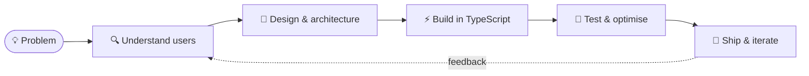
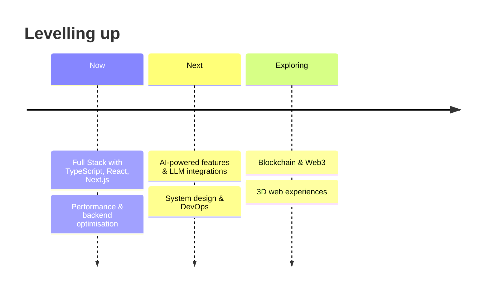

<!-- ═══════════════ HEADER BANNER ═══════════════ -->

 

  

 

<!-- ═══════════════ INTRO ═══════════════ -->
## Hi there 👋, I'm Bishwas!

> 💻 **Full Stack Developer who loves building web apps and open source projects.**

- 🌱 **Currently learning:** AI, Blockchain & System Design
- 🔭 **Working on:** The Smit Gifts platform and a 3D-first portfolio
- 🤝 **Open to collaborate on:** Open-source projects, eco-friendly apps and job-hunting tools
- 📫 **Reach me at:** [pandeybiswas1@gmail.com](mailto:pandeybiswas1@gmail.com) · [LinkedIn](https://www.linkedin.com/in/bishwas-pandey-5ab822316/) · [Portfolio](https://bishwaspandey.vercel.app/)
- ⚡ **Fun fact:** I debug with `console.log()` and stubborn persistence 😄

<!-- ═══════════════ RECRUITER TL;DR ═══════════════ -->
## ⚡ The 30-Second Scan

<table align="center">
  <tr>
    <td align="center" width="25%"><h3>💼</h3><b>Role</b> Full Stack Developer</td>
    <td align="center" width="25%"><h3>⏱️</h3><b>Experience</b> 2+ years</td>
    <td align="center" width="25%"><h3>🚀</h3><b>Shipped</b> 10+ projects</td>
    <td align="center" width="25%"><h3>🌍</h3><b>Works</b> Remote-friendly · UTC+5:45</td>
  </tr>
  <tr>
    <td align="center"><h3>🧩</h3><b>Core Stack</b> React · Next.js · Node · TypeScript</td>
    <td align="center"><h3>🗄️</h3><b>Data</b> MongoDB · MySQL</td>
    <td align="center"><h3>☁️</h3><b>Cloud</b> AWS · Cloudflare · Vercel</td>
    <td align="center"><h3>📬</h3><b>Reach me</b> <a href="mailto:pandeybiswas1@gmail.com">Email</a> · <a href="https://www.linkedin.com/in/bishwas-pandey-5ab822316/">LinkedIn</a></td>
  </tr>
</table>

<!-- ═══════════════ TECH ═══════════════ -->
## 🛠️ Tech Arsenal

**🎨 Frontend** 

**⚙️ Backend** 

**🗄️ Database & Cloud** 

**🧰 Tools & Workflow** 

**🧊 Creative & Low-level** 

<!-- ═══════════════ STATS ═══════════════ -->
## 📊 GitHub Analytics

 

**🟩 Contribution Calendar** 

<!-- ═══════════════ SNAKE ═══════════════ -->

### 🐍 Contribution Snake

<!-- ═══════════════ PROJECTS ═══════════════ -->
## 🚀 Featured Projects

<table>
  <tr>
    <td align="center" width="50%">
      
       <b>🧱 Basico</b> · a web app to track and improve everyday life
    </td>
    <td align="center" width="50%">
      
       <b>🎁 Smit Gifts React App</b> · production client project
    </td>
  </tr>
  <tr>
    <td align="center" width="50%">
      
       <b>🖱️ Virtual Mouse</b> · hand-gesture cursor control via webcam
    </td>
    <td align="center" width="50%">
      
       <b>🧮 LeetCode Solutions</b> · problem solving & DSA
    </td>
  </tr>
</table>

<b>🔎 What each project says about me</b>

 

| Project | Skill it proves | Highlights |
|---|---|---|
| 🧱 **Basico** | Product thinking & full-stack basics | A website that helps people track and improve their everyday life |
| 🎁 **Smit Gifts React App** | Real-world, production-grade engineering | Optimised modules, complete backend, built for a live business |
| 🖱️ **Virtual Mouse** | Python, computer vision & creativity | Index finger moves the cursor, pinch gestures trigger clicks, all from a webcam |
| 🧮 **LeetCode Solutions** | Algorithms & data structures | Consistent practice, optimised solutions, interview-ready thinking |

> 🌐 Want the live demos and full write-ups? See my [portfolio](https://bishwaspandey.vercel.app/).

<!--
  Repo names: Basico, smit-gift-react, Virtual-mouse, LEET-SOLUTIONS (case matters).
-->

<!-- ═══════════════ HOW I BUILD ═══════════════ -->
## 🧭 How I Build

<b>🧱 Engineering principles I stick to</b>

 

- ✅ **Readable over clever** — code is read far more than it is written
- ✅ **Performance is a feature** — fast pages convert and retain
- ✅ **Ship small, ship often** — meaningful commits, tight feedback loops
- ✅ **Design with empathy** — if users have to think, I haven't finished
- ✅ **Document as I go** — future me (and teammates) say thanks

<!-- ═══════════════ ROADMAP ═══════════════ -->
## 🗺️ Learning Roadmap

<!-- ═══════════════ CONNECT ═══════════════ -->
## 🤝 Let's Connect

**Got a product to build, a team to join, or an open-source idea to explore?**

  

⭐ If something here caught your eye, drop a star on a repo — it genuinely makes my day.

